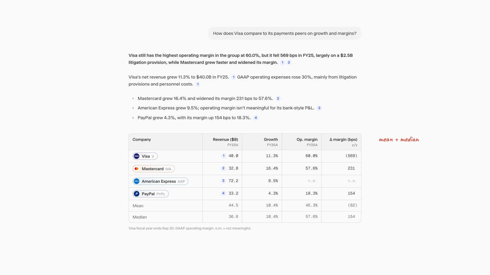

# ui-redline-walkthrough

A Claude skill that turns before/after screenshots of a product UI into an animated redline walkthrough: red ink and handwritten notes mark each problem on the real interface, the UI morphs into the fix, and the film ends on the clean redesign. Output is a self-contained HTML animation and a high-quality MP4.

## Example output

A chat answer redesign (a Visa vs. payments peers response), made with this skill from one before and one after screenshot. 19 seconds, 3200x1800, 60 fps.

[](examples/chat-response-redesign.mp4)

[Watch the MP4](examples/chat-response-redesign.mp4)

## Install

Copy the `ui-redline-walkthrough` folder into your skills directory (for Claude Code, `~/.claude/skills/`), or upload the packaged `.skill` file in Claude's skill settings.

## Requirements

- Python 3.9+ with `numpy`, `pillow`, `scipy`
- `playwright` with Chromium (`pip install playwright && playwright install chromium`) for stills and MP4 export
- `ffmpeg` on your PATH

## Contents

| Path | Purpose |
| --- | --- |
| `SKILL.md` | The workflow Claude follows |
| `references/intake.md` | Questions to ask before building, with defaults |
| `references/measuring.md` | Measuring screenshots, raster vs live markup, alignment traps |
| `references/choreography.md` | Beat structure, ordering, timing, camera, ink, notes, morph patterns |
| `references/review-checklist.md` | Polish checklist drawn from real review rounds |
| `assets/template.html` | Animation engine plus a runnable demo |
| `scripts/measure.py` | Boxes, colors, text lines and extents from screenshots |
| `scripts/extract_icons.py` | Icons cut out with clean transparency into one sprite |
| `scripts/export_mp4.py` | Frame-accurate stills and MP4 export via headless Chromium |
| `examples/` | A finished walkthrough MP4 and its preview still |

## Try the demo

Open `assets/template.html` in a browser (space pauses, arrow keys seek), or render it:

```bash
python scripts/export_mp4.py assets/template.html --out demo.mp4
```

## License

MIT
